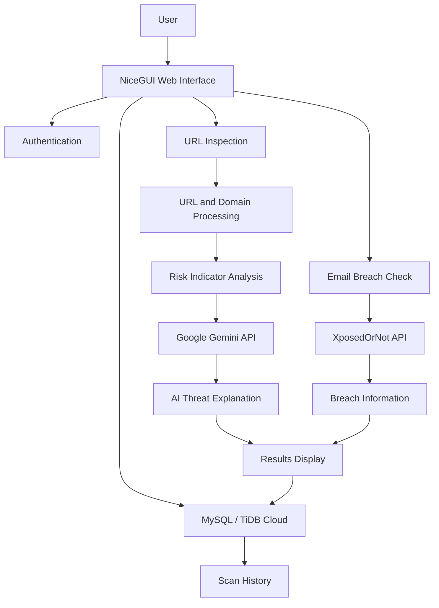

# 🛡️ AI Phishing & Threat Detector

An AI-powered cybersecurity web application that helps users inspect suspicious URLs, analyze potential phishing indicators, and check email addresses against known public data breaches using Google Gemini AI.

<p align="center">


</p>

<p align="center">

[🌐 Live Application](https://ai-phising-detector-m5z3.onrender.com/) · [📂 GitHub Repository](https://github.com/ShaikhVaiz/AI-Phising-Detector)

</p>

---

## 📑 Table of Contents

- [Overview](#-overview)
- [Problem Statement](#-problem-statement)
- [Key Features](#-key-features)
- [Application Screenshots](#-application-screenshots)
- [Technology Stack](#-technology-stack)
- [System Architecture](#-system-architecture)
- [How It Works](#-how-it-works)
- [Project Structure](#-project-structure)
- [Installation and Setup](#-installation-and-setup)
- [Environment Configuration](#-environment-configuration)
- [Running the Application](#-running-the-application)
- [Security Considerations](#-security-considerations)
- [Limitations](#-limitations)
- [Future Improvements](#-future-improvements)
- [Author](#-author)

---

## 📌 Overview

Phishing attacks use deceptive websites and URLs to trick people into sharing sensitive information.

The **AI Phishing & Threat Detector** provides a web-based interface for examining suspicious URLs and understanding potential security indicators.

The application combines rule-based URL inspection, domain analysis, email breach checking, and AI-generated explanations to make security information easier to understand.

It also includes user authentication, password recovery, and scan history management.

## 🎯 Problem Statement

Identifying phishing links can be difficult because malicious URLs may imitate legitimate websites, use misleading domain names, or contain suspicious structures.

Users also need a convenient way to understand whether their email addresses appear in known public data breaches.

This project aims to bring URL inspection and email exposure checking into one accessible application.

## ✨ Key Features

| Feature | Description |
|---|---|
| AI-Powered Threat Analysis | Uses Google Gemini API to explain URL security findings |
| URL Inspection | Analyzes submitted URLs for suspicious indicators |
| Domain Analysis | Extracts host and domain information |
| IP Address Detection | Identifies URLs using raw IP addresses |
| Suspicious URL Indicators | Checks HTTP usage, suspicious keywords, unusual URL length, and `@` symbols |
| Email Breach Checker | Checks email addresses against public breach information using XposedOrNot |
| User Authentication | Provides registration and login functionality |
| Password Protection | Uses bcrypt password hashing |
| Password Recovery | Supports email OTP-based password recovery through Resend |
| Scan History | Stores previous security checks in the database |
| Responsive Interface | Provides a cyber-themed NiceGUI interface |

## 📸 Application Screenshots

### 1. Login Page


### 2. Main Dashboard


### 3. Threat Analysis Result


---

## 🛠️ Technology Stack

| Component | Technology |
|---|---|
| Programming Language | Python |
| Frontend and UI | NiceGUI |
| AI Integration | Google Gemini API |
| Database | MySQL / TiDB Cloud |
| Authentication | bcrypt |
| Email Service | Resend |
| Breach Information | XposedOrNot API |
| Environment Configuration | python-dotenv |
| HTTP Requests | Requests, HTTPX |
| Deployment | Render |

## 🏗️ System Architecture



## ⚙️ How It Works

1. The user opens the application and signs in or creates an account.
2. The user selects the security check they want to perform.
3. For URL inspection, the application processes the submitted URL and extracts host information.
4. The application checks for suspicious indicators such as raw IP addresses, insecure HTTP, suspicious keywords, `@` symbols, and unusually long URLs.
5. Google Gemini generates an explanation based on the detected URL findings.
6. For email checks, the application queries XposedOrNot for known public breach information.
7. The application displays the findings and stores security check history in the database.

## 📁 Project Structure

```text
AI-Phising-Detector/
│
├── screenshots/
│   ├── Login_Page.png
│   ├── Dashboard_Page.png
│   └── Analysis_Result.png
│
├── dashboard.py
├── login_signup.py
├── requirements.txt
├── .gitignore
└── README.md
```

## 🚀 Installation and Setup

### Prerequisites

- Python 3.10 or later
- Git
- Google Gemini API key
- MySQL / TiDB Cloud database configuration
- Resend API key

### 1. Clone the Repository

```bash
git clone https://github.com/ShaikhVaiz/AI-Phising-Detector.git
cd AI-Phising-Detector
```

### 2. Create a Virtual Environment

```bash
python -m venv .venv
```

### 3. Activate the Virtual Environment

**Windows PowerShell:**

```powershell
.\.venv\Scripts\Activate.ps1
```

**Linux / macOS:**

```bash
source .venv/bin/activate
```

### 4. Install Dependencies

```bash
pip install -r requirements.txt
```

## 🔐 Environment Configuration

Create a `.env` file in the project root directory.

Add the required credentials:

```env
GEMINI_API_KEY=your_gemini_api_key
DB_PASSWORD=your_database_password
RESEND_API_KEY=your_resend_api_key
```

Replace the example values with your own credentials.

**Important:** Never upload your actual `.env` file, API keys, or database passwords to GitHub.

## ▶️ Running the Application

Start the application:

```bash
python dashboard.py
```

Open your browser and visit:

```text
http://localhost:8080
```

## 🔒 Security Considerations

- Passwords are hashed using bcrypt.
- API keys and database passwords should be stored in environment variables.
- Never commit private credentials to GitHub.
- Avoid submitting URLs containing private access tokens or confidential information.
- AI-generated findings should be treated as security assistance, not a guarantee that a website is safe.

## ⚠️ Limitations

- AI-generated assessments may be incomplete or incorrect.
- Rule-based URL analysis cannot detect every phishing technique.
- Email breach checks depend on the availability and coverage of the external breach information provider.
- The application is an educational security-assistance tool and does not replace professional security analysis.

Always verify suspicious websites independently before entering sensitive information.

## 🚀 Future Improvements

- Integrate additional URL reputation and threat intelligence sources.
- Improve domain and URL analysis.
- Add downloadable security reports.
- Improve scan history visualization.
- Expand automated testing.
- Improve threat detection accuracy.

## 👨‍💻 Author

**Shaikh Vaiz**

- GitHub: [@ShaikhVaiz](https://github.com/ShaikhVaiz)
- Repository: [AI-Phising-Detector](https://github.com/ShaikhVaiz/AI-Phising-Detector)

---

<p align="center">

**Built with Python, NiceGUI, and Google Gemini AI.**

</p>
