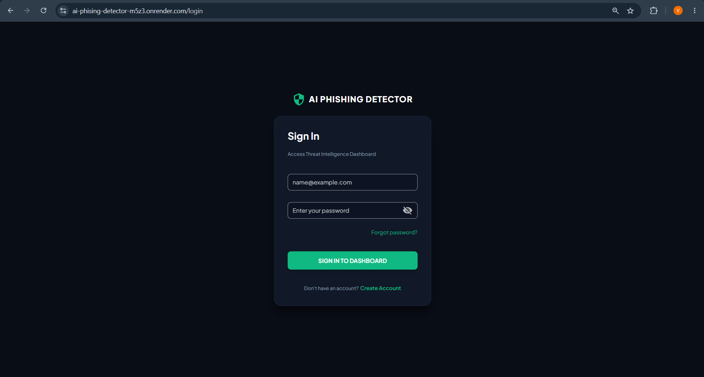
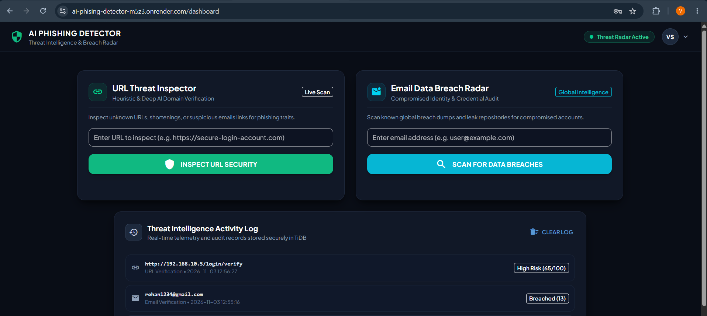
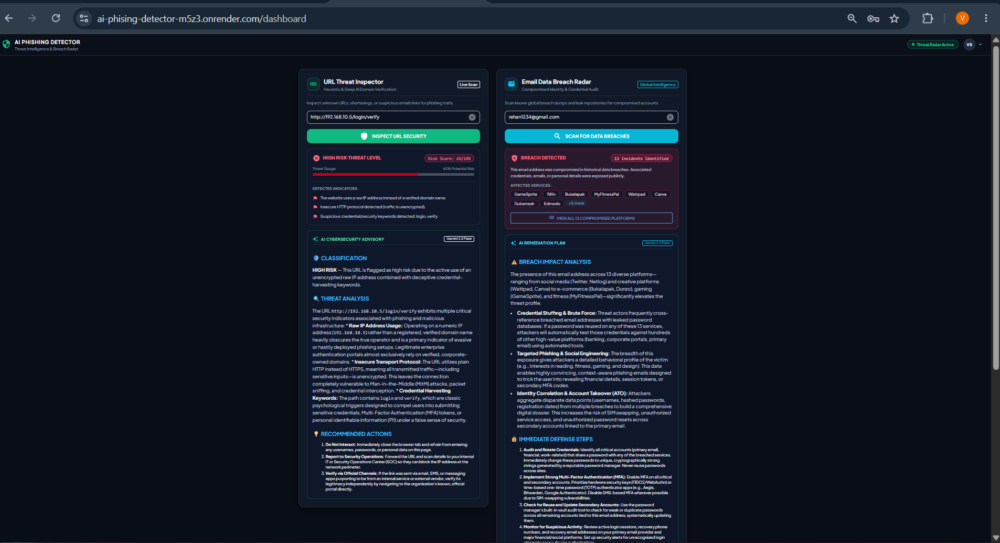

# 🛡️ AI Phishing & Threat Detector

An AI-powered cybersecurity web application designed to analyze suspicious URLs, identify potential phishing indicators, and provide intelligent threat assessments using **Google Gemini AI** and **Python NiceGUI**.

## 🌐 Live Application

[](https://ai-phising-detector-m5z3.onrender.com)

**Live Website:** https://ai-phising-detector-m5z3.onrender.com

## 📌 Project Overview

Phishing attacks use deceptive links and websites to trick users into revealing sensitive information.

This project provides a web-based tool that helps users examine suspicious URLs and understand potential security risks through AI-powered analysis.

The application combines URL parsing, domain inspection, authentication, database storage, and AI-generated threat assessments in one interface.

## ✨ Key Features

- 🔍 **AI-Powered Threat Analysis:** Uses Google Gemini API to evaluate suspicious URLs and provide security assessments.
- 🌐 **IP & Domain Analysis:** Extracts host information and identifies IP-based URLs and potential domain spoofing indicators.
- 🔐 **Secure Authentication:** User registration and login with bcrypt password hashing.
- 📜 **Scan History:** Stores previous security checks and related records in a MySQL database.
- 📊 **Threat Assessment:** Presents AI-generated security findings to help users understand potential URL risks.
- 🎨 **Modern User Interface:** Responsive dark-themed interface developed using Python NiceGUI.

## 📸 Application Screenshots

### 🔐 Login Page


### 🏠 Main Dashboard


### 🔍 Threat Analysis Result

## 🛠️ Technology Stack

| Component | Technology |
|---|---|
| Frontend & UI | NiceGUI |
| Backend | Python |
| AI Integration | Google Gemini API |
| Database | MySQL / TiDB Cloud |
| Authentication | Bcrypt |
| Email Service | Resend |
| Deployment | Render |

## ⚙️ How It Works

1. **User Input:** The user submits a suspicious URL.
2. **URL Processing:** The application extracts and examines domain and host information.
3. **AI Analysis:** The URL is sent for assessment using Google Gemini.
4. **Threat Evaluation:** The application presents potential security indicators and an AI-generated assessment.
5. **History Storage:** Previous scans are stored in the database for later reference.

## 🚀 Installation & Local Setup

### Prerequisites

- Python 3.10 or later
- MySQL or TiDB Cloud database
- Google Gemini API key
- Git

### 1. Clone the repository

```bash
git clone https://github.com/ShaikhVaiz/AI-Phising-Detector.git
cd AI-Phising-Detector
```

### 2. Create a virtual environment

```bash
python -m venv venv
```

**Windows:**
```bash
venv\Scripts\activate
```

**Linux / macOS:**
```bash
source venv/bin/activate
```

### 3. Install dependencies

```bash
pip install -r requirements.txt
```

### 4. Configure environment variables

Create a `.env` file in the project directory and add the required credentials:

```env
GEMINI_API_KEY=your_gemini_api_key
DB_PASSWORD=your_database_password
```

Configure any additional database or email settings required by your application.

**Important:** Never upload API keys, database passwords, or other secret credentials to GitHub.

### 5. Run the application

```bash
python dashboard.py
```

Open your browser and visit:

http://localhost:8080

## 🔒 Security Disclaimer

This application provides AI-assisted URL analysis for educational and informational purposes.

AI-generated assessments are not guaranteed to identify every phishing attempt. Always verify suspicious websites independently and avoid entering sensitive information on untrusted websites.

## 👨‍💻 Author

**Shaikh Vaiz**

- GitHub: [@ShaikhVaiz](https://github.com/ShaikhVaiz)
- Project Repository: [AI Phishing Detector](https://github.com/ShaikhVaiz/AI-Phising-Detector)

---

⭐ If you find this project interesting, consider starring the repository!
