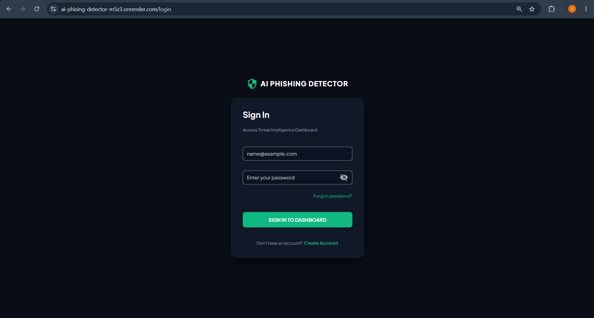
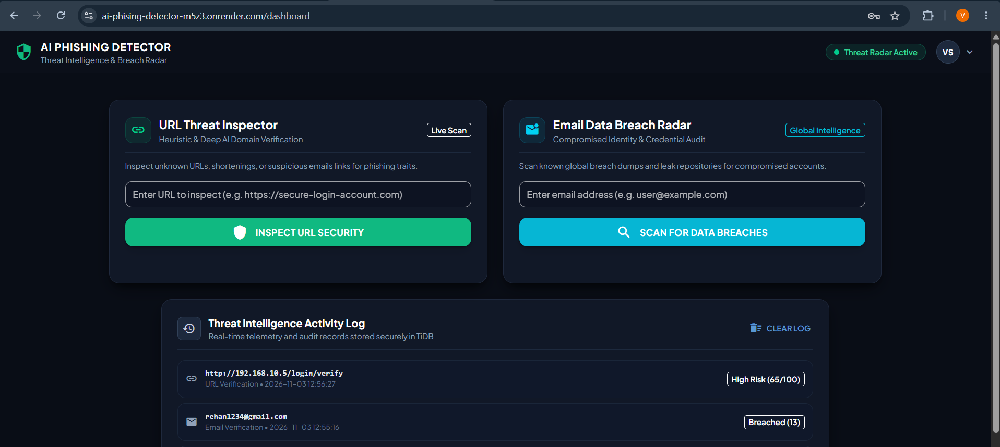
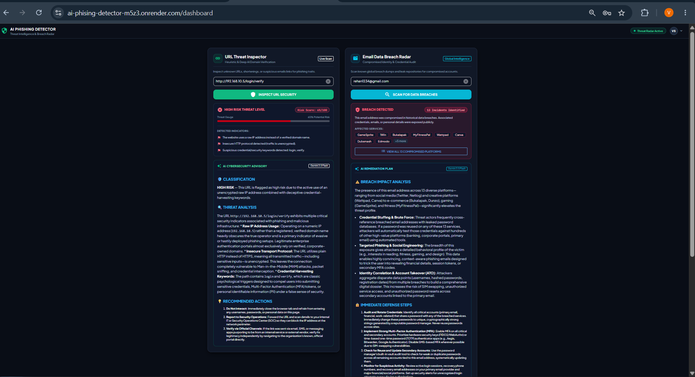
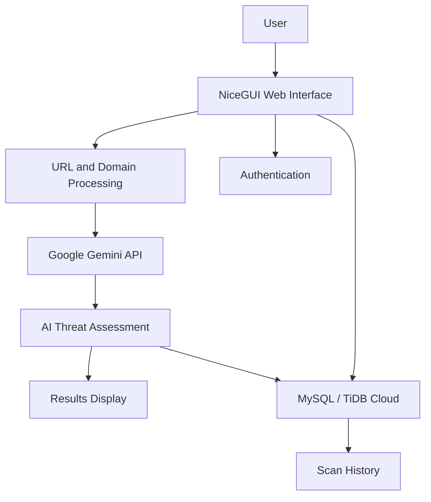

# 🛡️ AI Phishing & Threat Detector

An AI-powered cybersecurity web application that helps users analyze suspicious URLs, inspect domain information, and understand potential phishing risks through Google Gemini AI.

\<p align="center">   \   \   \   \   \ \</p>

\<p align="center">   \<a href="[https://ai-phising-detector-m5z3.onrender.com/](https://ai-phising-detector-m5z3.onrender.com/)">\<strong>🌐 Live Application\</strong>\</a> ·   \<a href="[https://github.com/ShaikhVaiz/AI-Phising-Detector](https://github.com/ShaikhVaiz/AI-Phising-Detector)">\<strong>📂 GitHub Repository\</strong>\</a> \</p>

---

## 📑 Table of Contents

- [Overview](#-overview)
- [Problem Statement](#-problem-statement)
- [Key Features](#-key-features)
- [Application Screenshots](#-application-screenshots)
- [Technology Stack](#-technology-stack)
- [System Architecture](#-system-architecture)
- [How It Works](#-how-it-works)
- [Project Structure](#-project-structure)
- [Installation and Setup](#-installation-and-setup)
- [Environment Configuration](#-environment-configuration)
- [Running the Application](#-running-the-application)
- [Security Considerations](#-security-considerations)
- [Limitations](#-limitations)
- [Future Improvements](#-future-improvements)
- [Author](#-author)

---

## 📌 Overview

Phishing attacks use deceptive websites and URLs to trick people into sharing sensitive information.

The **AI Phishing & Threat Detector** provides a web-based interface for examining suspicious URLs and understanding potential security indicators.

The application combines URL and domain inspection with AI-assisted threat assessment. It also provides user authentication and scan history management.

The project was developed using Python, NiceGUI, Google Gemini API, and MySQL-compatible database integration.

## 🎯 Problem Statement

Users may find it difficult to identify suspicious links because phishing URLs can imitate legitimate websites and use misleading domain names.

This project aims to make URL inspection more accessible by combining domain information with AI-generated security assessments in one application.

## ✨ Key Features

| Feature                    | Description                                                                                     |
| -------------------------- | ----------------------------------------------------------------------------------------------- |
| AI-Powered Threat Analysis | Uses Google Gemini API to assess submitted URLs                                                 |
| URL Inspection             | Processes submitted URLs for security analysis                                                  |
| IP and Domain Analysis     | Extracts host information and identifies IP-based URLs and potential domain spoofing indicators |
| User Authentication        | Provides registration and login functionality                                                   |
| Password Protection        | Uses bcrypt password hashing                                                                    |
| Scan History               | Stores previous security checks in the database                                                 |
| Threat Assessment          | Presents AI-generated findings in a user-friendly interface                                     |
| Responsive Interface       | Built using Python NiceGUI                                                                      |

## 📸 Application Screenshots

### 1. Login Page

\<p align="center">
&#x20; \
\</p>

### 2. Main Dashboard

\<p align="center">
&#x20; \
\</p>

### 3. Threat Analysis Result

\<p align="center">
&#x20; \
\</p>

## 🛠️ Technology Stack

| Component                 | Technology         |
| ------------------------- | ------------------ |
| Programming Language      | Python             |
| Frontend and UI           | NiceGUI            |
| AI Integration            | Google Gemini API  |
| Database                  | MySQL / TiDB Cloud |
| Authentication            | bcrypt             |
| Email Service             | Resend             |
| Environment Configuration | python-dotenv      |
| Deployment                | Render             |

## 🏗️ System Architecture



## ⚙️ How It Works

1. The user opens the application and signs in.
2. The user submits a URL for inspection.
3. The application processes the URL and extracts host and domain information.
4. Google Gemini API is used to generate an AI-assisted assessment.
5. The application displays the resulting security findings.
6. Previous scan information is stored in the database for later reference.

## 📁 Project Structure

```text
AI-Phising-Detector/
│
├── screenshots/
│   ├── Login_Page.png
│   ├── Dashboard_Page.png
│   └── Analysis_Result.png
│
├── dashboard.py
├── login_signup.py
├── requirements.txt
├── .gitignore
└── README.md
```

## 🚀 Installation and Setup

### Prerequisites

- Python 3.10 or later
- Git
- Google Gemini API key
- MySQL or TiDB Cloud database configuration

### 1. Clone the Repository

```bash
git clone https://github.com/ShaikhVaiz/AI-Phising-Detector.git
cd AI-Phising-Detector
```

### 2. Create a Virtual Environment

```bash
python -m venv .venv
```

### 3. Activate the Virtual Environment

**Windows PowerShell:**

```powershell
.\.venv\Scripts\Activate.ps1
```

**Linux / macOS:**

```bash
source .venv/bin/activate
```

### 4. Install Dependencies

```bash
pip install -r requirements.txt
```

### 5. Configure Environment Variables

Create a `.env` file in the project root and configure the credentials required by the application.

Example:

```env
GEMINI_API_KEY=your_gemini_api_key
DB_PASSWORD=your_database_password
```

Configure any additional database or email settings required by your deployment.

**Important:** Never commit your actual `.env` file, API keys, or database credentials to GitHub.

## ▶️ Running the Application

Start the application:

```bash
python dashboard.py
```

Open your browser and visit:

```text
http://localhost:8080
```

## 🔒 Security Considerations

- Passwords are protected using bcrypt hashing.
- API keys and database credentials should be stored in environment variables.
- Do not submit private or confidential URLs containing personal access tokens.
- AI-generated assessments should be treated as assistance, not a guarantee of website safety.

## ⚠️ Limitations

- AI-generated assessments may be incomplete or incorrect.
- A suspicious URL may not always be identified correctly.
- The application is an educational security-assistance tool and does not replace professional security analysis.

Always verify suspicious websites independently before entering sensitive information.

## 🚀 Future Improvements

- Add more URL reputation and threat intelligence sources.
- Improve domain and URL feature analysis.
- Add detailed scan reports.
- Improve historical scan visualization.
- Expand automated testing.

## 👨‍💻 Author

**Shaikh Vaiz**

- GitHub: [@ShaikhVaiz](https://github.com/ShaikhVaiz)
- Repository: [AI-Phising-Detector](https://github.com/ShaikhVaiz/AI-Phising-Detector)

---

\<p align="center">
&#x20; \<strong>Built with Python, NiceGUI, and Google Gemini AI.\</strong>
\</p>
